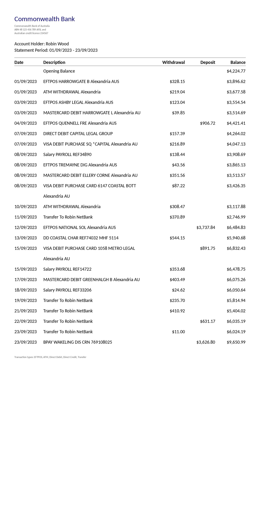
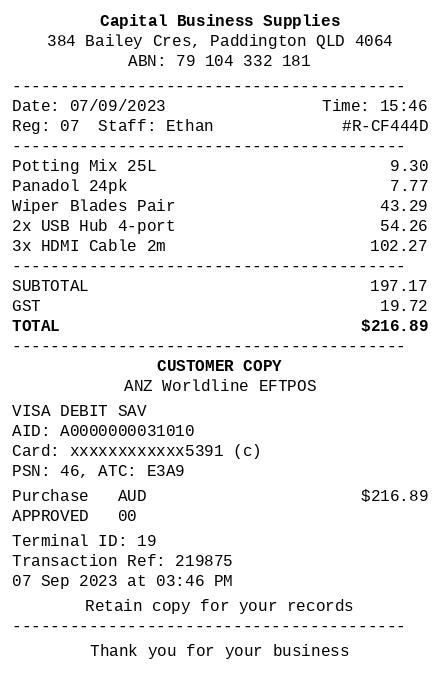
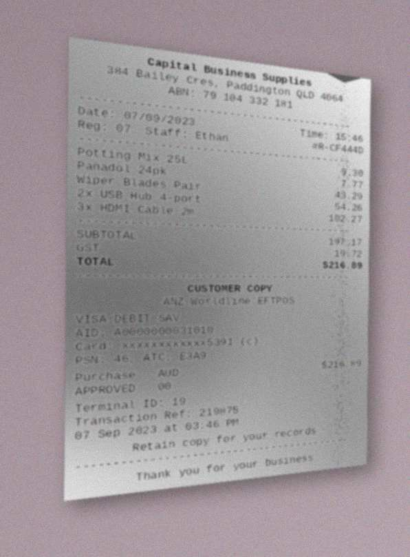
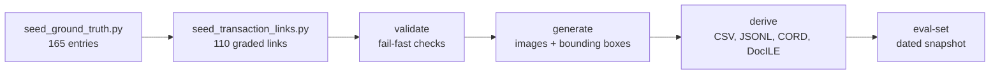

# Synthetic Document Corpus: A Walkthrough for Data Engineering

How the 55-case invoice, receipt and bank statement corpus was generated, and how an AI coding assistant was used
to build the generator. Prepared 26 October 2026; every count below was checked against the generator
repository on that date.

---

## 1. What it is

- **55 cases**, each one bank statement, one receipt and one invoice: **165 documents**.
- **22 visual layouts**: 8 bank (two each for CBA, Westpac, NAB, ANZ), 6 receipt (thermal 80 mm and
  57 mm, retail tax, fuel, professional, hospitality), 8 invoice.
- **110 transaction links**, each tying a receipt or invoice to a transaction row on the same case's
  bank statement.
- Australian document conventions throughout: ABNs, GST, DD/MM/YYYY dates. Document dates span 2023
  and 2024.

### Example pages: case 1, clean and heavily damaged

These six pages come from earlier versions of the corpus (August and September 2026), when bank
statements and invoices were damaged as well as receipts; the current corpus damages receipts only.
Click an image for full size.

| | Clean | Heavily damaged |
|---|---|---|
| Bank statement |  |  |
| Invoice |  |  |
| Receipt |  |  |

## 2. The key idea: the answers come first, then the page is drawn from them

- The usual approach is to collect real documents and pay people to label them. Here it runs the other
  way: field values are written first, in YAML, and the page is drawn from them.
- The value on record is exactly the string on the page, so there is no transcription error and no
  labeller disagreement.
- Bounding boxes come free: the renderer records each field's position as it draws it.
- One pass produces both the images and the ground truth, so the two cannot disagree.

## 3. The pipeline: six commands, no labelling step

| Stage | Command | Produces |
|---|---|---|
| Content | `python scripts/seed_ground_truth.py` | 165 entries with valid ABNs, correct GST, matching line-item counts |
| Relationships | `python scripts/seed_transaction_links.py` | 110 graded links, each with a written rationale |
| Check | `python -m generators.pipeline validate` | Required fields, layouts, ABN checksums, formats, overflow, real-name screen |
| Render | `python -m generators.pipeline generate` | Page images plus per-field bounding boxes |
| Export | `python -m generators.pipeline derive` | CSV, JSONL, CORD, DocILE projections |
| Eval set | `python -m generators.pipeline eval-set` | One dated, self-verifying snapshot |

## 4. Where the content comes from

- **Fixed random seed (42)**: the corpus is a pure function of its seed and can be rebuilt exactly.
- **Faker** (`en_AU`, version pinned) supplies only person names and street addresses.
- **Line items** come from curated catalogues keyed to each business's trade, so a fuel receipt never
  bills legal services.
- **Business names** are composed from name parts and screened against a blocklist of 41 real
  businesses. The generator fails rather than print a real company.
- **Built-in rules**: ABNs pass the real checksum, GST is one eleventh of a GST-inclusive total,
  parallel line-item lists always have matching counts.
- **Layouts are YAML**, not code: a declarative layout language with thirteen primitives (`text`,
  `pair`, `table`, `split` and so on). A new layout is a YAML edit; a new document type is a layout plus
  a renderer of about 70 lines.

## 5. Linking, with difficulty set on purpose

- Every link has an exact date and amount match. Difficulty is controlled by one thing only: how
  recognisable the merchant name is in the bank statement's description.

| Difficulty | Count | Bank description |
|---|---|---|
| Easy | 52 | Full merchant name |
| Medium | 36 | Abbreviated merchant reference |
| Hard | 22 | Further degraded merchant reference |

- The mix is a setting, not something discovered. A corpus could be built 80% hard if needed.

## 6. Privacy: realistic, but not real

- **Nothing real goes in.** No real document is read, transformed or de-identified at any point, so
  there is no underlying record to re-identify.
- **Deliberately real**: the four bank brand names, and suburbs and postcodes (paired with fabricated
  street numbers and names).
- **Residual risks, stated plainly**: ABNs pass the checksum but are not checked against the register;
  a Faker name could match a real person by chance.

## 7. What Data Engineering receives

One dated snapshot directory, `snapshot_<YYYYMMDD>/`, uploaded to S3:

- **`MANIFEST.json`**: generator commit, whether the working tree was modified, a hash of every config
  and ground-truth file, and a SHA-256 for every file. `verify_snapshot.py` checks it on the receiving
  side (standard library only).
- **Four paired sets of 165 images, sharing filenames**:
  - **plain**: the clean render;
  - **distractor**: decoy values a model must not extract (an ACN beside the ABN, a due date beside
    the invoice date);
  - **labelled_varied**: ABN, GST and total labels reworded or removed;
  - **degraded**: the 55 receipts as phone photos at three severity levels (light, moderate, heavy).
- **Ground truth** as CSV and JSONL (20 fields, `NOT_FOUND` where a field does not apply), plus the
  public CORD and DocILE formats so scores compare with published work.
- **Bounding boxes** for the three clean sets.
- **Filenames do not reveal the layout**, so a model cannot infer the template from the name.

## 8. Known limits

- **No negative links**: every link is a true match, so the set measures recall but not precision.
- **No bounding boxes on degraded images**: the camera warp does not carry them.
- **Degradation is tuned for legibility**, not validated against real phone photos.
- **The heavy tier is not bit-reproducible**: the snapshot itself is the record.

---

## 9. How an AI coding assistant was used

### The framing

AI can be used to **generate the images**. Here AI was used to **write the generator**. The images come
from ordinary, deterministic code, so the ground truth is exact by construction and the whole corpus
rebuilds from seed 42. A generative image model cannot guarantee that the text on the page matches its
label.

### Who did what

- **The author**: the goals, and the invariants that must never break: every scored value printed
  verbatim on the page, no real businesses, no silent clipping, YAML as the single source of
  configuration.
- **The AI coding assistant**: design documents, staged implementation plans, code, tests and documentation; it
  also ran validation and kept the documents consistent.
- **Model inference** ran separately on the GPU host. The assistant never generated or scored the data
  itself.

### How it was set up

- **A standing instructions file** sets the engineering standards for every session: fail-fast errors in
  four parts (what is wrong, where to fix it, a valid example, how to recover), tests before every
  commit, pinned dependencies, British spelling.
- **Persistent memory**: 26 notes carry decisions and lessons from one session to the next.
- **Big changes follow one path**: design document, then a staged plan, then sub-agents implementing task
  by task with a review per task. The distractor overhaul is the worked example: one design document
  plus plans for Stages 0 to 7.
- **Scale**: about 30,000 lines of generator code and about 2,000 test functions, built since May 2026.

### Lessons worth passing on

1. **Check the AI's plans against the code.** In one stage the code samples in its plans were wrong
   9 times in about 16 tasks. They were caught because the implementing agents were told that the real
   files win over the plan.
2. **'No tests ran' can look like a pass.** The untracked test suite silently vanished. It was rebuilt
   in a day; now it is tracked in git, and an empty run counts as a failure.
3. **Rigour has a cost.** One stage took about 28 hours of review-and-fix cycles, and the test suite
   grew to 55 minutes. The answer was one review per task and a commit gate of about 2 minutes, with the
   full suite run only before a release.
4. **Rules must be specific.** A general instruction did not stop AI attribution slipping into public
   commits in other repositories. Specific prohibitions plus a check before every push did.
5. **Never put real evaluation data in prompt examples.** A model being scored reads the prompt, so a
   real value in an example hands it part of the answer.

---

## 10. The generator repository

`github.com/tmnestor/Synthetic_Doc_Generation`, private at present.
